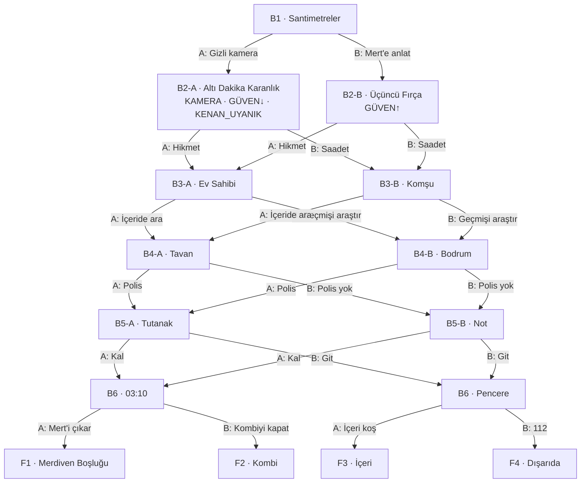

# AŞAMA 2 — ANA HİKÂYE: "YEDEK ANAHTAR"

> *"Bir evin kaç anahtarı olduğunu, o evde yaşayanlar hiçbir zaman tam olarak bilmez."*

Bu dosya üretim ekibi içindir. Bütün sırları, geçmiş olayları, ipuçlarını, A/B dallarını ve finalleri içerir. Hiçbir bölümde izleyiciye burada yazan her şey birden verilmez.

---

## 0. SEÇİLEN FİKRİN ZAYIFLIKLARI NASIL GİDERİLDİ

Aşama 1'de "Yedek Anahtar"ın üç riski vardı. Ana hikâye bu üç riske göre yeniden kuruldu:

| Risk | Çözüm |
|------|-------|
| **Tanıdık konsept** ("evde gizlice yaşayan biri") | Bu, hikâyenin cevabı değil, ilk katmanı. Asıl gizem *neden orada olduğu*, *kimin bildiği* ve evde onunla birlikte bulunan **ikinci görünmez tehdit**: karbonmonoksit. |
| **Tahmin edilebilirlik** | İlahi anlatıcı bilinçli olarak izleyiciye karakterlerden fazlasını söyler (Hitchcock'un "masanın altındaki bomba" ilkesi). İzleyici "biri var" diye tahmin ettiğinde korku bitmez, büyür. Çünkü karakterlerin bilmediği ve izleyicinin de tam çözemediği bir şey daha vardır: sabah baş ağrıları. |
| **"Bul / bulma" ikiliğine sıkışan seçimler** | Seçimler beş farklı eksene yayıldı: güven (eş), bilgi kaynağı (ev sahibi / komşu), arama yöntemi (içeri / dışarı), yetkili (polis / kendin), gece (kal / git), müdahale (kendin gir / profesyonel yardım). |

---

## 1. EVREN

**Yer:** İstanbul, Anadolu yakasında eski bir semt. Kurgusal **Ihlamur Sokak No: 14, Ihlamur Apartmanı.**

**Bina:** 1978 yapımı, zemin + 3 kat, toplam 8 daire, her katta 2 daire. Asansör yok. Merdiven boşluğu dar, mozaik basamaklı. En üst katın üstünde **çatı arası** var. Çatı arasına merdiven boşluğunun en üst sahanlığındaki küçük, kilitli metal bir kapıdan çıkılıyor. Bodrumda her dairenin numaralı bir **kömürlüğü** (depo bölmesi) var.

**Daire 7:** 3. kat (en üst kat), sağ taraf. 2+1, yaklaşık 85 m². Ahşap parke ve yüksek tavanlar. Giriş koridorunun ve banyonun üstünde, bir zamanlar kiracı tarafından yapılmış **asma tavan depo** var (yaklaşık 1 m yüksekliğinde). Deponun kapağı koridor tavanında. 60×60 cm, tavanla aynı beyaza boyanmış, itince açılan gizli mandallı. Deponun arka duvarındaki sökülebilir bir panel, binanın çatı arasına açılıyor.

**Daire 8:** Aynı kat, karşı daire. Saadet Ünal'ın evi.

**Kombi:** Daire 7'nin koridorundaki gömme dolapta, asma tavanın tam altında. Baca borusu asma tavanın içinden geçip dış duvardaki menfeze çıkıyor.

**Termostat:** Koridor duvarında kablosuz bir oda termostatı. Telefona bağlı bir uygulaması var. Uygulama her ayar değişikliğini saatiyle kaydediyor ve elle yapılan değişikliklere "Manuel ayar" yazıyor.

**Zaman:** Kasım 2026. İlk kez kombilerin yakıldığı, sonra ilk donun düştüğü haftalar.

**Tekrar eden semboller:**

| Sembol | Anlamı (ilk başta gizli) |
|-------|--------------------------|
| **03:10** | Nurten'in morfin saatiydi. Ölüm saati de oldu. |
| **Parkedeki soluk izler** | Eşyaların 14 yıl boyunca durduğu yerler. |
| **Turuncu alev** | Kötü yanma. Karbonmonoksit. |
| **Üşümek** | Nurten hep üşürdü. Kenan hâlâ onu ısıtmaya çalışıyor. |
| **Anahtar / "SARI ANAHTAR" damgası** | Kenan'ın meslek mührü. Hikâyenin başlığı ve son sırrı. |
| **Kesik işaret parmağı** | Kenan'ın sol işaret parmağının ucu yok. Onu görmeden tanımanın tek yolu. |
| **Ayla'nın eskiz defteri** | Ayla evi her gün çiziyor. Değişimlerin görsel kaydı bu defterde tutuluyor. |

---

## 2. KARAKTERLER (5)

> Fiziksel detaylar, master promptlar ve referans sayfaları Aşama 3'te hazırlanacak. Burada hikâyedeki işlevleri anlatılıyor.

### AYLA DEMİR (30) — Ana karakter
Serbest çalışan bir çocuk kitabı illüstratörü. Evden çalışıyor, bu yüzden evdeki değişiklikleri ilk o fark ediyor. Eskiz defterine her gün evden bir köşe çiziyor. Bu, hem karakter özelliği hem de hikâyenin kanıt aracı. Detaycı, sezgisi güçlü, kendine güvenmekte zorlanan biri. "Abarttığı" söylenmeye alışık.
**Korkusu:** Kimsenin ona inanmaması.
**İşlevi:** İzleyicinin gözü. İzleyici seçimleri onun ağzından yapıyor.

### MERT DEMİR (33) — Eş
Lojistik planlama uzmanıydı. **İki ay önce işten çıkarıldı ve Ayla'ya söylemedi.** Her sabah işe gidiyormuş gibi çıkıyor, günlerini kafelerde iş başvurusu yaparak geçiriyor, bazı günler Ayla dışarıdayken gizlice eve dönüyor. Ucuz kiralı bu evi bu yüzden ısrarla istedi. Pragmatik, gururlu. Tuhaflıkları önce reddediyor, çünkü kabul ederse kendi sırrının da ortaya çıkacağından korkuyor.
**Korkusu:** Yetersiz görünmek.
**İşlevi:** İlk bölümlerde kırmızı ringa (şüpheli). Güven ekseninin diğer ucu.

### KENAN SARI (52) — "Evdeki üçüncü kişi"
Mahallenin eski çilingiri. Köşedeki **"SARI ANAHTAR"** dükkânını 20 yıl işletti. 2010'dan beri Daire 7'de oturuyordu. Asma tavan depoyu 2012'de ev sahibinin izniyle kendi elleriyle yaptı. Karısı Nurten 14 Ocak 2025'te, gece 03:10'da, bu evde kanserden öldü. Ondan sonra Kenan çöktü: dükkân kapandı, borçlar birikti, kira üç katına çıktı. Şimdi zayıf ve sessiz biri. Bakımsız kır sakallı, Nurten'in ördüğü gri atkıyı hiç çıkarmıyor. Sol işaret parmağının ucu, gençliğinde anahtar makinesine kaptırdığından eksik.
**Gerçek:** Evden hiç ayrılmadı. Asma tavanda yaşıyor.
**Korkusu:** Nurten'in eşyalarının, yani ondan geriye kalan son şeyin atılması.
**İşlevi:** Görünmeyen tehdit. Ama bir canavar değil. Hikâyenin trajik merkezi.

### SAADET ÜNAL (73) — Karşı komşu
Dul, emekli bir terzi. Nurten'in 14 yıllık en yakın arkadaşı. Kenan'ın yukarıda olduğunu baharın başından beri biliyor. Her gece çatı arası kapısının önüne sarılı bir tabak yemek bırakıyor. Kimseye söylemedi, çünkü söylerse Kenan'ın "deli" diye bir yere kapatılacağına inanıyor. Az konuşuyor, ama söylediği her cümlenin iki anlamı var.
**Korkusu:** Bir kez daha birini kaybetmek. Ve bu suskunluğun bir gün birine zarar vermesi.
**İşlevi:** Geçmişin tanığı, ahlaki ağırlık. Bilgi kaynağı ya da engel.

### HİKMET AKSOY (61) — Ev sahibi
Bir mahalle ötede oturan, üç dairesi olan emekli bir memur. Kibar, ölçülü, ama göz teması kurmuyor. **Şubat 2026'da Kenan bir psikiyatri servisinde yatarken kilidi değiştirdi, eşyalarını bodruma attırdı ve evi yasa dışı yollarla boşalttı.** Bu yüzden polisten kaçınıyor. Evde "bir şeyler olduğundan" şüpheleniyor, çünkü bir önceki kiracı 23 gün sonra kaçtı. Ama açıkça bakmaya cesaret edemiyor. Kirayı piyasanın %40 altına bu yüzden indirdi.
**Korkusu:** Yaptığının ortaya çıkması.
**İşlevi:** Kırmızı ringa, ikinci şüpheli. Hikâyenin asıl suçlusu belki de o.

> **Nurten Sarı** (ö. 49 yaşında) yalnızca fotoğraflarda, eşyalarda ve anılarda var. Konuşan karakter değil, karakter sınırına dahil edilmedi.
> **Polis memurları ve itfaiyeciler** yüzleri net gösterilmeyen figüranlar. Diyalogları yok ya da tek cümlelik.

---

## 3. GİZLİ GEÇMİŞ (Kronoloji)

| Tarih | Olay |
|------|------|
| 2006 | Kenan "SARI ANAHTAR" dükkânını açıyor. Mahallede kopyaladığı **her anahtarın bir yedeğini, adresiyle etiketleyip** saklamaya başlıyor. Ona göre bu bir "meslek alışkanlığı", çünkü insanlar anahtarlarını kaybettiğinde ona geliyor. |
| 2010 | Kenan ve Nurten Daire 7'ye taşınıyor. Daire 8'deki Saadet ile Nurten yakın arkadaş oluyor. Nurten, Saadet'e acil durumlar için evin **yedek anahtarını** veriyor. |
| 2012 | Kenan, Hikmet'in sözlü izniyle koridor ve banyonun üstüne asma tavan depoyu yapıyor. |
| Haziran 2024 | Nurten'e pankreas kanseri tanısı konuyor. Evde bakılıyor. Ağrısı en çok gece artıyor. Kenan her gece **03:10'da** ona morfin veriyor ve odayı ısıtmak için termostatı bir derece yükseltiyor. Nurten hep üşüyor. |
| 14 Ocak 2025, 03:10 | Nurten evde, yatak odasında ölüyor. |
| 2025 boyunca | Kenan çöküyor. Dükkân kapanıyor. Kira artışlarını ödeyemiyor ve borçlanıyor. |
| Şubat 2026 | Kenan sinir krizi geçirip 9 gün bir psikiyatri servisinde yatıyor. **Hikmet bu sırada kilidi değiştiriyor, nakliyecilere eşyaları bodrumdaki kömürlüğe attırıyor**, kapıya el yazısıyla bir not bırakıyor: *"Kilit değişti. Eşyaların bodrumda. — H.A."* (Bu yasa dışı bir tahliye.) |
| Şubat 2026 | Kenan taburcu olup döndüğünde kapıyı kilitli buluyor. Çilingir olduğu için girmesi beş dakika sürüyor. Nurten'in eşyalarını bodrumdan asma tavana taşıyor ve **orada yaşamaya başlıyor.** Deponun arka panelini çatı arasına açıyor. Çatı arası kapısının anahtarı zaten onda. |
| Şubat 2026 (devam) | Nakliyeciler eşyaları bodrumdaki 7 numaralı kömürlüğe bırakıyor. Kenan kömürlüğe kendi eski pirinç asma kilidini takıyor. Asma kilidin yedeği, daire anahtarlarıyla birlikte kapıdaki eski anahtarlıkta kalmıştı. Hikmet bu anahtarlığı "eski kiracının anahtarları" diye alıp hiçbir şeye bakmadan yeni kiracılara veriyor. Kenan en değerli eşyaları (hırka, fotoğraflar, örgü) depoya taşıyor, gerisi bodrumda kalıyor. |
| Mart–Haziran 2026 | Daire boş, boyanıyor. Kenan gündüz depoda, gece evde. Eşyaları ve mobilyaları **eski yerlerine** çekiyor. |
| Nisan 2026 | Saadet bir gece çatı arasından gelen öksürüğü tanıyor. Kimseye söylemiyor. Yemek bırakmaya başlıyor. |
| Temmuz 2026 | Öğrenci kiracı **Burak** taşınıyor. **23 gün sonra** "evde biri var" diyerek kaçıyor. Hikmet kapağı açıp depoya bakıyor, yalnızca koliler görüyor. Kenan çatı arasındaki su deposunun arkasında saklanıyor. (Yaz olduğu için kombi kapalı. **Burak bu yüzden zehirlenmedi.**) |
| Ekim 2026 | Havalar soğuyor. Depo buz gibi. Kenan, baca borusunun depodan geçen eklemini gevşetip etrafını bezle sarıyor ki sıcak hava depoya sızsın. **Sıcak havayla birlikte baca gazı, yani karbonmonoksit de sızmaya başlıyor.** Gaz önce depoda birikiyor, kapağın aralıklarından koridora ve yatak odasına iniyor. Kenan'ın zihin bulanıklığının, unutkanlığının ve "Nurten'in sesini duymasının" bir kısmı bu kronik zehirlenmeden kaynaklanıyor. |
| 1 Kasım 2026 | **Ayla ve Mert taşınıyor.** Hikâye başlıyor. |

### Hikâyenin özü (tek paragraf)
Bir evde iki görünmez şey yaşar. Biri bir yasın içinde kaybolmuş, evden atılmış ve evden çıkamayan bir adamdır. Diğeri onun farkında olmadan yarattığı kokusuz bir gazdır. Ayla adamı ararken asıl tehlikenin ne olduğunu görmez. Adam da karısını ısıtmaya çalışırken herkesi, kendisi de dahil, yavaşça öldürdüğünü bilmez. İzleyici seçimleriyle iki şeye karar verir: Ayla gerçeği **ne zaman** ve **kimden** öğrenecek, ve son gece **kim** hayatta kalacak.

### Gizemler ve cevapları

| Gizem (izleyicinin sorusu) | Cevap | İlk ipucu | Tam açıklama |
|----------------------------|-------|-----------|--------------|
| Eşyaları kim, neden yerinden oynatıyor? | Kenan. Eşyaları Nurten'in yaşadığı zamandaki yerlerine geri koyuyor. | B1: parkedeki izler | B3B / B4 (fotoğraf) |
| Termostat neden her gece 03:10'da yükseliyor? | Kenan'ın morfin ritüeli, Nurten'in ölüm saati. | B1: açılış | B4B (ölüm belgesi) / B5B (not) / B7 |
| Mert bir şey mi saklıyor? | Evet, işsiz kaldığını. Ama evdeki olaylarla ilgisi yok (bardak hariç). | B1 | B2A ya da B2B |
| Ev sahibi neden ucuza verdi, neden polis istemiyor? | Yasa dışı tahliye yaptı, ortaya çıkmasından korkuyor. | B1 (kira) | B4B (not) / B5A / B7 |
| Saadet ne biliyor? | Her şeyi. Kenan'ı besliyor. | B1 ("kaloriferi kısma") | B3B / B7 |
| Sabah baş ağrıları neden? | **Karbonmonoksit.** | B1 (ilk sabah) | B6 |
| Eski pirinç anahtar neyi açıyor? | Bodrumdaki kömürlüğü. | B1 | B4B (ya da B7) |
| **Son sır:** Kenan'ın depodaki kilitli metal kutusu | Mahalleden 16 yılda kopyaladığı **214 yedek anahtar**, hepsi adres etiketli. | B1 (SARI ANAHTAR damgası), B3A ("çilingir"), B4A (kutu) | B7 (bütün sonlar) |

---

## 4. DURUM BAYRAKLARI (Dallanma değişkenleri)

Her A/B seçimi bir sonraki bölümü belirliyor ve **kalıcı bir bayrak** bırakıyor. Bayraklar sonraki bölümlerdeki repliklerin, kanıtların ve finalin ayrıntılarını değiştiriyor.

| Bayrak | Kaynak | Değerler | Etkisi |
|-------|--------|----------|--------|
| `KAMERA` | Seçim 1 | var / yok | Kenan'ın elinin görüntüsü elde var mı? Kamera daha sonra depoda bulunur. |
| `GÜVEN` | Seçim 1 | düşük / yüksek | Ayla–Mert ilişkisi, kavgalar, finaldeki ilişki durumu. |
| `KENAN_UYANIK` | Seçim 1 | evet / hayır | Kenan izlendiğini biliyor mu? Biliyorsa daha temkinli ve daha gergin. |
| `KAYNAK` | Seçim 2 | Hikmet / Saadet | Bilgi kimden geliyor, kim müttefik? |
| `ARAMA` | Seçim 3 | içeri / dışarı | İçeri: depoyu ve gevşek baca borusunu gördüler. Dışarı: bodrumdaki tahliye notunu ve geçmişi buldular. |
| `POLİS` | Seçim 4 | evet / hayır | Tutanak var mı? Hikmet çatı kapısına asma kilit vurdu mu? |
| `GECE` | Seçim 5 | kal / git | Bölüm 6'nın mekânı ve olayları. |
| `MÜDAHALE` | Seçim 6 | 4 farklı final | Kim hayatta kalıyor? |

**Kural:** Seçilmeyen dalda olan hiçbir olay, sonraki bölümlerde yaşanmış gibi anılamaz. Her bölüm varyantının başında "Bu varyantta bilinenler / bilinmeyenler" listesi bulunur (Bölüm 5'e bakın).

---

## 5. YEDİ BÖLÜMÜN GENEL AKIŞI VE BÜTÜN DALLAR

Toplam önceden planlanan bölüm versiyonu: **1 + 2 + 2 + 2 + 2 + 2 + 4 = 15.** Yayında yalnızca seçilen 7 bölüm üretilir.

Zaman çizelgesi (Aşama 4'te kesinleşti): B1 1–6 Kasım · B2 7–8 Kasım · B3 9 Kasım ve 9'u 10'una bağlayan gece · B4 11 Kasım gündüz · **B5-A** 11 Kasım akşamı → B6 11'i 12'sine bağlayan gece · **B5-B** 11 Kasım akşamı – 12 Kasım → B6 12'yi 13'üne bağlayan gece · B7 ertesi sabah + sonsöz (14 Ocak 2027).

---

### BÖLÜM 1 — "SANTİMETRELER" (tek versiyon)

**Açılış (0–3 sn):** Karanlık yatak odası, iki kişi uyuyor. Telefonun ekranı kendiliğinden yanıyor: termostat uygulaması — *"03:10 · Manuel ayar · 22°C → 23°C."*
**Anlatıcı:** *"O gece evde kimse uyanık değildi. Termostat yine de değişti."*

**Akış:**
- **Taşınma günü.** Hikmet anahtarları veriyor. Halkada üç anahtar var: dış kapı, daire kilidi ve üzerinde **"SARI ANAHTAR"** damgası olan eski bir pirinç anahtar. Hikmet: *"Alttakini boş verin, eski."*
- Karşı kapının aralığından Saadet bakıyor. Ayla'ya tek cümle söylüyor: *"Kaloriferi kısma kızım. Bu ev soğuğu sevmez."*
- İlk sabahlar: ikisinin de başı ağrıyor. Mert: *"Boya kokusu."*
- Ayla'nın kupasının kulpu her sabah başka yöne dönük. Sandalyeler masaya itilmiş. Ayakkabılık koridorun ortasına, tavanın belli bir noktasının altına çekilmiş. Mert: *"Sen yapmışsındır."*
- Ayla eskiz defterine evi çiziyor. Çizimleri karşılaştırınca değişiklikleri görüyor.
- Ayla koltuğun ayaklarının yerini bantla işaretliyor.
- **Cliffhanger:** Sabah koltuk tam 40 cm kaymış, parkedeki dört soluk çukurun tam üstüne. 14 yıl boyunca durduğu yere.
**Anlatıcı:** *"Ev, eski düzenini hatırlıyordu. Ya da biri, onun yerine hatırlıyordu."*

**SEÇİM 1**
- **A — Mert'e söylemeden gizli bir kamera kur.** (Ayla, Mert'in bir şey sakladığını seziyor.)
- **B — Mert'e her şeyi anlat ve bu gece birlikte uyanık kalın.**

---

### BÖLÜM 2-A — "ALTI DAKİKA KARANLIK" (Seçim 1 = A)
**Bayraklar:** `KAMERA=var`, `GÜVEN=düşük`, `KENAN_UYANIK=evet`

- Ayla ucuz bir Wi-Fi kamerayı kitaplığa, kitapların arasına saklıyor. Oturma odasını ve koridorun girişini görüyor.
- **Gündüz bildirimi, 11:04:** Hareket algılandı. Görüntüdeki kişi Mert. Hafta içi, öğle saatinde, karanlık mutfakta oturmuş telefonundaki ret maillerine bakıyor. Ayla o sırada yayınevinde. **Hiçbir şey söylemiyor.**
- **Gece, 03:08:** Kamera "Çevrimdışı". **03:16:** Tekrar çevrimiçi, ama duvara dönük.
- Ayla son kareleri geri sarıyor: Bulanık bir el kameraya uzanıyor. **Sol işaret parmağının ucu eksik.**
- **Cliffhanger:** Ayla yanında uyuyan Mert'in eline bakıyor. On parmak, hepsi tam. Sonra tekrar ekrandaki ele.
**Anlatıcı:** *"Ayla o gece iki şey öğrendi. Kocası ona yalan söylüyordu. Ve o yalan, evdeki en korkunç şey değildi."*

**SEÇİM 2:** **A — Ev sahibi Hikmet'i ara.** / **B — Karşı komşu Saadet Hanım'ın kapısını çal.**

### BÖLÜM 2-B — "ÜÇÜNCÜ FIRÇA" (Seçim 1 = B)
**Bayraklar:** `KAMERA=yok`, `GÜVEN=yüksek`, `KENAN_UYANIK=hayır`

- Ayla, Mert'e her şeyi anlatıyor. Gerginlik büyüyor ve Mert itiraf ediyor: İki aydır işsiz. Kupayı o çevirmiş, bazı günler evdeymiş. Ama koltuğu o çekmemiş. Termostatı da o değiştirmemiş.
- Birlikte uyanık kalmaya karar veriyorlar. Çay, ışıklar kapalı, kanepe.
- 02:00 civarı ağır bir uyku basıyor ikisine de. *(Gaz. Anlatıcı söylemiyor, yalnızca gösteriyor: Ayla'nın göz kapakları, duvar saati.)*
- **03:10:** Koridordan termostatın tık sesi geliyor. Ayla yarı uyanık, kımıldayamıyor. Banyodan musluk sesi.
- **Sabah:** Banyo aynasının kenarları buğulu, havlu ıslak. Diş fırçası bardağında **üç fırça** var. Üçüncüsü eski ve kılları dağılmış.
- **Cliffhanger:** Bardağın yakın çekimi.
**Anlatıcı:** *"İki kişi taşınmıştı bu eve. Banyoda üç diş fırçası vardı."*

**SEÇİM 2:** **A — Ev sahibi Hikmet'i ara.** / **B — Karşı komşu Saadet Hanım'ın kapısını çal.**

---

### BÖLÜM 3-A — "EV SAHİBİ" (Seçim 2 = A)
**Bayrak:** `KAYNAK=Hikmet`

- Hikmet geliyor. Nazik ama gergin.
  - *`KAMERA=var` ise:* Ayla eldeki kareyi gösteriyor. Hikmet donuyor, farkında olmadan kendi sol işaret parmağına dokunuyor ve dudaklarından bir isim kaçıyor: *"…Kenan."* Hemen toparlanıyor: *"Yok, bilmiyorum."*
  - *`KAMERA=yok` ise:* Ayla üçüncü fırçayı gösteriyor. Hikmet fırçayı hızla çöpe atıyor: *"Önceki kiracıdan kalmıştır. Çilingir bozuntusunun biriydi, Kenan, borcunu ödemeden kaçtı."*
- Hikmet ağzından kaçırıyor: Ondan sonraki kiracı Burak da 23 gün sonra çıkıp gitmiş.
- Polis lafı açılınca sertleşiyor: *"Polis gelirse bu ev bir daha kiraya gitmez."* Kilidi kendisi değiştirmeyi teklif ediyor (şüpheli).
- Koridordan geçerken gözü bir saniye tavana kayıyor. Ayla bunu görüyor.
- Mert ve Hikmet kombiye bakıyor. **Alev turuncu.** Hikmet: *"Normaldir."*
**Anlatıcı:** *"Kombinin alevi turuncuydu. Bunun ne anlama geldiğini o evde bilen tek kişi, o sırada tavanın içinde uyuyordu."*
- *`GÜVEN=düşük` ise:* Ayla, Mert'le kamera görüntüsü yüzünden yüzleşiyor. Mert: *"Beni mi izliyorsun?"* İlk büyük kavga.
- **Gece 02:00:** Ayla pencereden Hikmet'in arabasını görüyor. Sokağın karşısında, motor kapalı, binayı izliyor.
- **Cliffhanger:** Saat 03:10'da termostat bildirimi geliyor. Hikmet hâlâ aşağıda, arabada. Ayla anlıyor: Termostatı Hikmet değiştirmiyor. Ama Hikmet *bir şey* bekliyor.

**SEÇİM 3:** **A — Evin içini ara (tavanlar, dolaplar, duvarlar).** / **B — Kenan'ın geçmişinin izini sür (bodrum, eski dükkân).**

### BÖLÜM 3-B — "KOMŞU" (Seçim 2 = B)
**Bayrak:** `KAYNAK=Saadet`

- Saadet, Ayla'yı içeri alıyor. Çay. Duvarda bir fotoğraf: Nurten ve Kenan, Daire 7'nin oturma odasında. **Koltuk parkedeki izlerin tam üstünde, ayakkabılık koridor tavanının altında.**
- Saadet: *"Nurten o evde öldü. Hep üşürdü."* Kenan'ı sorunca: *"Gitti."* Ama gözleri bir an tavana kayıyor.
  - *`KAMERA=var` ise:* Ayla kareyi gösteriyor. Saadet kesik parmağı görünce telefonu eliyle kapatıyor: *"Bunu kimseye gösterme."*
  - *`KAMERA=yok` ise:* Ayla üçüncü fırçadan bahsediyor. Saadet hiçbir şey söylemiyor, fincanı titriyor.
- Ayla mutfak tezgâhında bezle örtülmüş, ayrılmış bir tabak yemek görüyor. Saadet yalnız yaşıyor.
- *`GÜVEN=düşük` ise:* Eve dönen Ayla, kamera meselesi yüzünden Mert'le kavga ediyor. *(3-A'daki kavganın aynısı, burada Saadet ziyaretinden sonra.)*
- **Gece:** Ayla kapı deliğinden bakıyor. Saadet elinde tabakla merdivenin en üst sahanlığına, çatı arası kapısına çıkıyor ve tabağı yere bırakıyor.
- **Cliffhanger:** Saadet aşağı indikten sonra çatı kapısı içeriden yavaşça aralanıyor. Bir el tabağı alıyor. Elin işaret parmağının ucu yok.

**SEÇİM 3:** **A — Evin içini ara.** / **B — Kenan'ın geçmişinin izini sür (bodrum, eski dükkân).**

---

### BÖLÜM 4-A — "TAVAN" (Seçim 3 = A)
**Bayrak:** `ARAMA=içeri`

- Ayla eskizlerini yan yana diziyor ve fark ediyor: Ayakkabılık her sabah koridor tavanında aynı noktanın altına dönüyor. Ayakkabılığın üstünde tozlu ayak izleri var. Tavanda, gri bir kurum çizgisi bir kareyi çerçeveliyor.
- Kare itiliyor ve kapak açılıyor. Mert telefon feneriyle yukarı çıkıyor. *(`GÜVEN=düşük` ise Ayla çıkıyor, Mert'e güvenmiyor.)*
- **Depo:** Nurten'in eşyaları küçük bir oda gibi dizilmiş. Katlanmış hırkası, çerçeveli fotoğrafı, tarihli boş morfin kutuları, bir yatak, battaniye, termos ve bir defter. Bir de **kilitli metal bir kutu.**
  - *`KAMERA=var` ise:* Kayıp kamera yatağın üstünde. Kenan almış.
- **Baca borusu:** Eklemi gevşetilmiş, bezle ve bantla sarılmış. Dokununca sıcak. *(Karakterler bunun ne demek olduğunu anlamıyor. Kamera bir an fazla kalıyor.)*
- Deponun arka duvarında bir panel. Arkası karanlık, çatı arası.
- **Cliffhanger:** Mert'in feneri panele dönüyor ve panel öbür taraftan, yavaşça kapanıyor.

**SEÇİM 4:** **A — Polisi ara.** / **B — Polisi arama (kendiniz çözün).**

### BÖLÜM 4-B — "BODRUM" (Seçim 3 = B)
**Bayrak:** `ARAMA=dışarı`

- Ayla eski pirinç "SARI ANAHTAR"ı deniyor ve anahtar bodrumdaki 7 numaralı kömürlüğü açıyor.
- İçeride "NURTEN" yazılı koliler, sökülmüş bir anahtar kopyalama makinesi, "SARI ANAHTAR" dükkân tabelası. Kenan'ın dükkânında çekilmiş bir fotoğrafı (kesik parmak net görünüyor). Şubat 2026 tarihli bir hastane taburcu kâğıdı.
- **Kanıt:** Hikmet'in el yazısıyla kapıya bırakılmış not: *"Kilit değişti. Eşyaların bodrumda. — H.A."* Ayla bunun ne anlama geldiğini anlıyor: Kenan evinden atılmış.
- **Nurten'in ölüm belgesi:** 14.01.2025, saat 03:10.
**Anlatıcı:** *"Bazı saatler bir kez yaşanır. Bazıları her gece yeniden."*
- Ayla notu cebine koyup yukarı çıkıyor. Koridorda ilk kez başını kaldırıp tavana bakıyor: Boyada belli belirsiz bir kare, ayakkabılığın üstünde toz izleri.
- **Cliffhanger:** Tam başının üstünden hafif bir gıcırtı. Şu an. Orada.

**SEÇİM 4:** **A — Polisi ara.** / **B — Polisi arama (kendiniz çözün).**

---

### BÖLÜM 5-A — "TUTANAK" (Seçim 4 = A)
**Bayrak:** `POLİS=evet`

- İki polis memuru geliyor. Depoyu açıyorlar *(`ARAMA=dışarı` ise ilk kez)*. Yatak, eşyalar, termos. Kenan yok.
- Panelden çatı arasına bakıyorlar. Boş görünüyor.
**Anlatıcı:** *"Polisler çatı arasında dört dakika kaldı. Kenan Sarı, su deposunun arkasında, o dört dakika boyunca nefesini tuttu."*
- Hikmet çağrılıyor. Kenan'dan "dengesiz biri, evden kendi isteğiyle çıktı" diye bahsediyor.
  - *`ARAMA=dışarı` ise:* Ayla'nın cebinde Hikmet'in notu var. Hikmet konuşurken Ayla'nın eli cebinde. Göstermiyor. *(Bu not finalde kullanılacak.)*
- Tutanak tutuluyor. Polisler "devriye arttıracağız" diyor. Hikmet, yarın usta getirip depoyu ve çatı arasını kapattıracağını söylüyor ve **çatı arası kapısına o gece asma kilit vuruyor.**
- Saadet kapı aralığından asma kilidi izliyor. Yüzü.
- *`GÜVEN=düşük` ise:* Mert, Ayla'nın ona danışmadan karar verdiğini söylüyor. *`GÜVEN=yüksek` ise:* Birbirlerine tutunuyorlar.
- **Cliffhanger:**
**Anlatıcı:** *"Saadet'in tabağı o gece kapının önünde soğudu. Kenan Sarı'nın dışarı çıkabileceği tek bir yol kalmıştı: Ayla'ların koridoru."*

**SEÇİM 5:** **A — Bu gece evde kal.** / **B — Bu gece evden ayrıl.**

### BÖLÜM 5-B — "NOT" (Seçim 4 = B)
**Bayrak:** `POLİS=hayır`

- Mert onu zorla çıkarmak istiyor, Ayla konuşmak.
  - *`GÜVEN=yüksek` ise:* Bir not bırakmaya birlikte karar veriyorlar.
  - *`GÜVEN=düşük` ise:* Sert bir kavga. Mert *"yarın polisi ben ararım"* diyor. Ayla notu yine de bırakıyor.
  - *`ARAMA=dışarı` ise:* Ayla notu yazarken Kenan'ın geçmişini bildiği için şefkatli bir dil kullanıyor.
- Ayla notu ayakkabılığın üstüne, kapağın tam altına bırakıyor: *"Kenan Bey. Sizi biliyoruz. Konuşmak istiyoruz."*
- **Sabah:** Not gitmiş. Yerinde **daire kapılarının yeni kesilmiş bir kopya anahtarı** ve titrek bir el yazısıyla bir kâğıt parçası: *"Nurten üşür. Kaloriferi kısmayın."*
- Mert'in rengi atıyor. Bu adam her kapıyı açabiliyor. Ve ölmüş bir kadının üşüdüğünü düşünüyor.
- Baş ağrıları kötüleşiyor, Ayla sabah kusuyor. *(Herkes "stres" diyor.)*
- **Cliffhanger:** Ayakkabılığın üstündeki parlak, yeni anahtarın yakın çekimi.
**Anlatıcı:** *"Bir anahtarın kopyasını çıkarmak üç dakika sürer. Bir evin kime ait olduğunu unutmak ise çok daha uzun."*

**SEÇİM 5:** **A — Bu gece evde kal.** / **B — Bu gece evden ayrıl.**

> **İki 5. bölüm varyantında da ortak hazırlık:** O gün ilk don düşüyor. Ayla ve Mert, baş ağrısını sıcağa bağladıkları ve doğalgaz faturasından korktukları için termostatı **19°C'ye** indiriyor. *(Bu, B6'daki zirve anını hazırlıyor.)*

---

### BÖLÜM 6-KAL — "03:10" (Seçim 5 = A)
**Bayrak:** `GECE=kal`

- Karanlık oturma odası. *`POLİS=evet` ise:* Mert'in elinde bir çekiç var ve kapının sürgüsü çekili. *`POLİS=hayır` ise:* Konuşmak için bekliyorlar.
- 02:40 sularında ağırlık çöküyor. Mert kanepede uyukluyor. *(Çekiç elinden kayıyor.)*
- **03:10:** Koridordaki termostattan tık sesi geliyor. Kapak açılıyor. İki bacak ayakkabılığın üstüne iniyor.
- **Kenan ilk kez tam görünüyor:** Zayıf, kır sakallı, gri atkılı, kesik parmaklı. Onları görmüyor gibi yatak odasının kapısına yürüyor, boş yatağa bakıyor: *"Nurten?"*
- Ayla: *"Kenan Bey."* Kenan dönüyor. Gözleri bulanık: *"Üşüyor… kaloriferi kim kıstı?"* Termostatı 28°C'ye çeviriyor ve kombi gürleyerek çalışıyor.
- Kenan sendeliyor ve duvara yaslanarak yere kayıyor.
- Ayla ayağa kalkıyor, oda dönüyor. Mert'i sarsıyor ama Mert uyanmıyor.
**Anlatıcı:** *"Ayla'nın başındaki ağrı, taşındıkları günden beri aynı yerdeydi. Kombinin alevi turuncuydu. Ve o evde rengi, kokusu, sesi olmayan bir şey, her gece biraz daha birikiyordu."*
- **Cliffhanger:** Ayla dizlerinin üstünde, baygın Mert ile yerdeki Kenan arasında.

**SEÇİM 6:** **A — Mert'i sürükle ve dışarı çık.** / **B — Önce kombiyi kapat, pencereleri aç.**

### BÖLÜM 6-GİT — "PENCERE" (Seçim 5 = B)
**Bayrak:** `GECE=git`

- Ayla ve Mert gece arabada, sokağın karşısında, 3. kattaki kendi pencerelerinin tam karşısında kalıyor. *(Yeni mekân yok, sokak B1'den beri tanıdık.)*
- 01:30'da Ayla fark ediyor: **Başı ağrımıyor.** Taşındıkları günden beri ilk kez. Mert'in de ağrımıyor.
- Telefonuna "evden çıkınca geçen baş ağrısı" yazıyor. İlk sonuç: **karbonmonoksit zehirlenmesi.**
- Hafıza parçaları: Saadet'in *"kaloriferi kısma"*sı, *`KAYNAK=Hikmet` ise* turuncu alev, *`ARAMA=içeri` ise* bantlı baca borusu.
- **03:10:** Telefonda termostat bildirimi: *"Manuel ayar · 19°C → 28°C."*
- Pencerede bir siluet. Yavaş. Sonra eğiliyor ve görüş alanından düşüyor.
- *`POLİS=evet` ise:* Ayla anlıyor: Kenan'ın gidecek başka yeri yoktu, çünkü çatı kapısı kilitli.
- **Cliffhanger:** Boş pencere.

**SEÇİM 6:** **A — Koşup içeri gir.** / **B — 112'yi ara ve dışarıda bekle.**

---

### BÖLÜM 7 — "YEDEK ANAHTAR" (4 final)

#### Final 1 — "MERDİVEN BOŞLUĞU" (Kal + Mert'i çıkar)
Ayla, Mert'i kollarından sürükleyerek koridordan çıkarıyor. Yerde yatan Kenan'ın yarı açık gözleri onu izliyor. Kenan'ı geride bırakıyor. Sahanlıkta Saadet'in kapısını yumrukluyor ve Saadet 112'yi arıyor. Ayla geri girmeye kalkınca Saadet onu tutuyor: *"Girme."* İtfaiye Mert'i canlı çıkarıyor. Kenan'ı ise üstü örtülü bir sedyeyle.
**Ton:** Hayatta kalmanın bedeli. En karanlık son.

#### Final 2 — "KOMBİ" (Kal + kombiyi kapat)
Ayla sürünerek kombi dolabına gidiyor, gaz vanasını kapatıyor, pencereleri açıyor ve yere yığılıyor. Soğuk hava içeri doluyor. Pencerenin dibindeki Kenan ayılıyor ve kısa, berrak bir anında Mert'i, sonra Ayla'yı sahanlığa sürüklüyor. Onları tehlikeye atan adam onları kurtarıyor. Sonra merdivenin basamağına oturuyor, açık kapıya bakıyor ve içeri geri girmiyor.
**Ton:** Herkes hayatta. Kefaret.

#### Final 3 — "İÇERİ" (Git + koşup içeri gir)
Ayla merdivenleri koşarak çıkıyor. Mert arkasından 112'yi arıyor. Ayla nefesini tutup içeri giriyor, pencereleri açıyor ve Kenan'ı sürüklemeye çalışıyor ama başı dönüyor ve koridorda yığılıyor. Mert onu dışarı çekiyor, itfaiye Kenan'a ulaşıyor. Ayla iki gün hastanede kalıyor. Kenan yaşıyor ama karbonmonoksitin kalıcı hasarı yüzünden Nurten'in ölümünden bu yana geçen iki yılı hatırlamıyor. Onun için Nurten hâlâ yaşıyor.
**Ton:** Cesaretin bedeli. Gerçekçi tıbbi sonuç.

#### Final 4 — "DIŞARIDA" (Git + 112'yi ara)
Ayla 112'ye en doğru cümleyi söylüyor: *"Karbonmonoksit şüphesi, içeride bilinci kapalı biri var."* Beklerken bina zilini çalıyor, Saadet'i ve komşuları dışarı çıkarıyor (gaz bitişik dairelere de sızabilir). İtfaiye solunum cihazlarıyla yedi dakikada geliyor ve Kenan'ı canlı çıkarıyor.
**Anlatıcı:** *"Doğru olan, çoğu zaman en kahramanca olan değildir."*
**Ton:** En iyi son. Gerçek hayatta yapılması gereken.

#### Bütün finallerde değişen ayrıntılar (bayraklara göre)

| Bayrak | Finaldeki etkisi |
|-------|------------------|
| `POLİS=evet` | Hikmet'in vurduğu asma kilit Kenan'ı eve hapsettiği için soruşturmanın merkezinde. Önceki tutanak Ayla'yı destekliyor. |
| `POLİS=hayır` | Kenan'ın bıraktığı kopya anahtar ve not kanıt oluyor. Ayla ilk kez *"neden daha önce aramadınız?"* sorusuyla yüzleşiyor. |
| `ARAMA=dışarı` | Ayla, Hikmet'in "Kilit değişti" notunu savcılığa veriyor. Hikmet yasa dışı tahliyeden yargılanıyor. |
| `ARAMA=içeri` | Bilirkişi raporu gevşetilmiş baca eklemini belgeliyor. Hikmet'in sorumluluğu (kombi bakımı, CO dedektörü yokluğu) dosyaya giriyor. |
| `KAYNAK=Saadet` | Saadet suskunluğunun bedelini açıkça yaşıyor. Ayla'yla arasında sessiz bir anlaşma var. |
| `KAYNAK=Hikmet` | Saadet'in sırrını Ayla ancak finalde öğreniyor. |
| `GÜVEN=yüksek` | Sonsözde Ayla ve Mert yeni bir evde, birlikte. Banyoda iki fırça. |
| `GÜVEN=düşük` | Sonsözde Ayla yeni evde yalnız koli açıyor. Banyoda tek fırça. *(B2-B'deki "üç fırça"nın yankısı.)* |

#### Ortak son sahne (bütün finaller) — "214"
Sonsöz: **14 Ocak 2027.** Nurten'in ölümünün ikinci yılı.
- Saadet, Ayla'ya bir zarf veriyor. İçinde eski bir anahtar var: Nurten'in 2010'da ona verdiği Daire 7 yedeği. *"Nurten bana vermişti. Kenan'a hiç söylemedim."* *(Bu anahtar artık hiçbir kapıyı açmıyor. Kilidi Hikmet değiştirdi.)*
- Polis tutanağından bir sayfa: Depodaki kilitli metal kutu açılmış. İçinde **214 anahtar**, her biri Kenan'ın el yazısıyla adres etiketli. Kenan 16 yıl boyunca mahallede kopyaladığı her anahtarın bir yedeğini saklamış.
- Son görüntü: Ayla yeni evinin kapısında, anahtarı kilide sokmak üzere. Duruyor ve elindeki anahtara bakıyor.
**Anlatıcı (son cümle):** *"Kenan Sarı'nın kutusunda iki yüz on dört anahtar vardı. Hiçbiri çalınmamıştı. Hepsini, kapılarının sahipleri kendi elleriyle getirmişti. Polis, bu anahtarlardan yüz doksanının hâlâ kapılarını açtığını tespit etti. Kilitler hiç değiştirilmemişti."*
**Son ekran yazısı:** *"Sizin evinizin yedek anahtarı kimde?"*

> Bu son sahne bir ters köşe değil: B1'deki damga, B3-A'daki "çilingir", B4-A'daki kilitli kutu ve B4-B'deki kopyalama makinesiyle önceden ekildi. Kenan'ın kötü niyetli olup olmadığı **bilerek açık bırakılıyor.** Yorumlardaki tartışma buradan çıkacak.
> **Sorumlu yayın notu:** Final kartının altında kısa bir bilgi satırı olabilir: "Kombi bakımı ve CO dedektörü hayat kurtarır."

---

## 6. DALLANMA HARİTASI

Yapı **"dallan ve birleş"** modelinde: Her bölüm iki versiyonla yazılıyor, versiyonlar bir sonraki seçim noktasında birleşiyor, ama her seçim kalıcı bir bayrak bırakıyor. Böylece 64 ayrı yol yerine yönetilebilir 15 bölüm versiyonu yazılıyor ve her seçim yine de finale kadar izini sürdürüyor.

---

## 7. DAL BİLGİ TABLOSU (çelişki önleme)

Her bölüm başında karakterlerin **ne bildiği**. Bir bilgi yalnızca kendi dalında var.

| Bilgi | Hangi dalda öğreniliyor | Diğer dalda |
|------|-------------------------|-------------|
| Mert'in işsizliği | B2-A (Ayla gizlice öğreniyor), B2-B (itiraf) | Her iki dalda öğreniliyor, *yolu* farklı. B2-A'da Mert, Ayla'nın bildiğini B3'teki kavgada öğreniyor. |
| Kesik parmak | B2-A (kamera), B3-B (kapı aralığı), B4-B (fotoğraf), B6 (yüz yüze) | `KAMERA=yok` + `KAYNAK=Hikmet` + `ARAMA=içeri` yolunda kesik parmak ilk kez B6'da ya da B5-A'daki polis fotoğrafında görülür. |
| "Kenan" adı | B3-A (Hikmet), B3-B (Saadet) | Her yolda B3'te öğreniliyor. |
| Nurten'in ölüm saati 03:10 | B4-B (belge) | B4-A yolunda: B5-B'deki notla ima ediliyor, B7'de anlatıcıyla açıklanıyor. |
| Yasa dışı tahliye | B4-B (not) | B4-A yolunda B7'deki soruşturmada açıklanıyor. |
| Bantlı baca borusu | B4-A | B4-B yolunda B5-A'da polis görür ama önemsemez, ya da B7 bilirkişi raporunda çıkar. |
| Saadet'in Kenan'ı beslemesi | B3-B | `KAYNAK=Hikmet` yolunda B5-A'da (soğuyan tabak) ya da B7'de. |
| Turuncu alev | B3-A | `KAYNAK=Saadet` yolunda B6'da anlatıcı söylüyor. |
| Karbonmonoksit | B6 (iki varyant) | Hiçbir dalda B6'dan önce karakterler tarafından bilinmiyor. İzleyiciye yalnızca ima ediliyor. |
| Metal kutu / 214 anahtar | B4-A'da kutu görülüyor, B7'de içeriği açıklanıyor | Bütün yollarda yalnızca B7'de açıklanıyor. |

---

## 8. İPUCU EKME → KARŞILIK TABLOSU

| İpucu | Ekildiği yer | Karşılığı |
|------|--------------|-----------|
| Sabah baş ağrıları | B1, her sabah | B6: CO |
| "Boya kokusu" bahanesi | B1 | Boya bahanesi 2. haftada geçersizleşiyor |
| Saadet: "Kaloriferi kısma" | B1 | B3-B: Nurten üşürdü · B5-B: Kenan'ın notu · B6: termostat 28°C |
| SARI ANAHTAR damgası | B1 | B4-B: kömürlük · B7: 214 anahtar |
| Ayakkabılığın yeri | B1 | B4: kapak tam üstünde |
| Parkedeki izler | B1 | B3-B / B4-B: eski fotoğraflar |
| Termostat 03:10 | B1 | B4-B: ölüm saati · B6: ritüel |
| Ağır uyku | B2-B | B6: CO |
| Turuncu alev | B3-A | B6 |
| Hikmet'in tavana bakışı | B3-A | B7: biliyordu |
| Hikmet'in arabası | B3-A | B7: Kenan'ı yakalamaya çalışıyordu, polis olmadan |
| Saadet'in tabağı | B3-B | B5-A: soğuyan tabak · B7 |
| Bantlı baca | B4-A | B6 / B7 |
| Kilitli metal kutu | B4-A | B7 |
| Ayla'nın eskizleri | B1–B4 | B7: soruşturmada kanıt olarak (opsiyonel) |

---

## 9. KORKU TASARIMI İLKELERİ (bütün bölümler için)

1. **Hiçbir doğaüstü olay yok.** Her "imkânsız" anın fiziksel bir açıklaması var ve finale kadar açıklanıyor.
2. **Ani korkutma en fazla bölüm başına bir kez**, o da ses değil, *görüntü* yoluyla (açılan kapak, kapanan panel).
3. **Korku sıradan nesnelerden doğuyor:** Kupa, diş fırçası, termostat uygulaması, ayakkabılık, anahtar.
4. **Anlatıcı bilgiyi bir silah gibi kullanıyor:** İzleyiciye karakterlerden bir adım fazlasını söylüyor, ama asla iki adım fazlasını değil.
5. **Kötü adam yok, sorumluluk var:** Kenan'ın yası, Hikmet'in açgözlülüğü, Saadet'in suskunluğu, Mert'in yalanı. Her biri kendi küçük kararıyla o geceye katkıda bulunuyor.
6. **İzleyicinin kendine soracağı soru:** *"Benim evimde CO dedektörü var mı? Benden önce bu evde kim yaşadı? Benim anahtarımın kaç kopyası var?"*

---

*Aşama 2 tamamlandı. Onayınızı ya da değişiklik isteklerinizi bekliyorum. Onaydan sonra Aşama 3'e geçeceğim: karakter master promptları, mekân master promptları, referans sayfası talimatları ve bina/daire haritası.*
